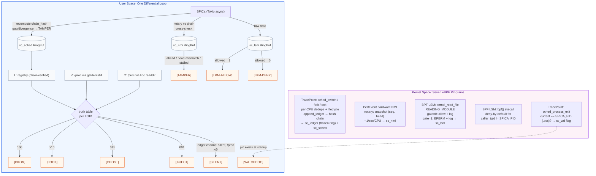
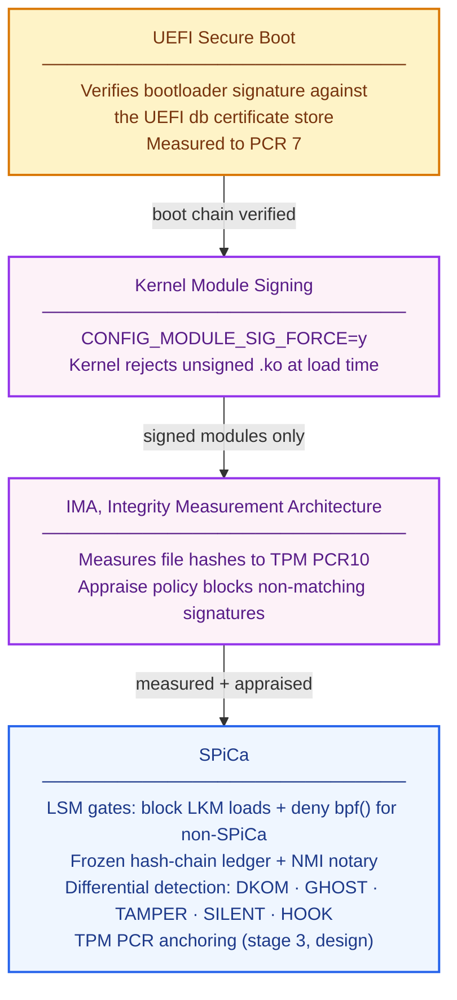

# SPiCa
**System Process Integrity & Cross-view Analysis**

<p align="center">
  
</p>

> "I'm going to sing, so shine bright, SPiCa..."

SPiCa is an eBPF-based Linux rootkit detector written in Rust. The name comes from the Hatsune Miku song *SPiCa* and the star it references — Spica (Alpha Virginis), the brightest point in Virgo. What looks like a single star to the naked eye is actually a spectroscopic binary: two stars in mutual orbit, indistinguishable as separate objects without measuring their spectra. SPiCa applies the same principle to kernel observation: multiple independent channels measure the same kernel state from physically distinct mechanisms, and a rootkit that suppresses one is exposed by the others.

> **Disclaimer:** Significant portions of this codebase were generated or refactored with GLM assistance. Rigorous testing and iterative design were applied, but review the code for security and performance before production use.

---

## Table of Contents

1. [Threat Model](#1-threat-model)
2. [Architecture Overview](#2-architecture-overview)
3. [The sched\_switch Ledger Writers](#3-the-sched_switch-ledger-writers)
4. [The NMI Ledger Notary](#4-the-nmi-ledger-notary)
5. [Detection Logic](#5-detection-logic)
6. [Integrity Model: Freeze + Chain + Notary](#6-integrity-model-freeze--chain--notary-and-why-the-old-secrecy-claim-was-wrong)
7. [LSM Gates: Module Blocking + Deny-by-Default `bpf()`](#7-lsm-gates-module-blocking--deny-by-default-bpf)
8. [Why There Is No Key](#8-why-there-is-no-key)
9. [TPM PCR Anchoring (Implemented) + One-Time Uninstall Token (Design)](#9-tpm-pcr-anchoring-implemented--one-time-uninstall-token-design)
10. [Defense in Depth](#10-defense-in-depth)
11. [The BTF Bug Incident](#11-the-btf-bug-incident)
12. [Known Limitations & Attack Surface](#12-known-limitations--attack-surface)
13. [Build & Run](#13-build--run)
14. [Roadmap](#14-roadmap)
15. [Glossary](#15-glossary)

---

## 1. Threat Model

### The constrained adversary: the eBPF rootkit

SPiCa is designed to defeat the **eBPF-constrained adversary** — an attacker with elevated privileges (CAP\_BPF or CAP\_SYS\_ADMIN) who loads a privileged eBPF program into the kernel. This adversary is fundamentally weaker than an LKM rootkit because the BPF verifier imposes hard constraints:

| Constraint | Effect on adversary |
|---|---|
| Bounded loops (~1M instructions per program) | Cannot scan all of kernel memory |
| Pointer safety (direct dereference requires provably valid, bounded target) | Cannot follow arbitrary pointers |
| Restricted helpers (per-program-type allowlist) | Cannot call `kmalloc`, `vmalloc`, or any kernel allocation function |
| No arbitrary kernel write (`bpf_probe_write_kernel` heavily restricted) | Cannot modify `task_struct`, tracepoint funcs arrays, or BPF program bytecode |
| Map access scoped to loaded references | Cannot access maps belonging to other programs (ID enumeration is closed by the deny-by-default `bpf()` gate — see [§7](#7-lsm-gates-module-blocking--deny-by-default-bpf)) |

With LKMs blocked by the LSM gate after boot, this constrained adversary is the realistic remaining threat. SPiCa's anti-evasion machinery is calibrated for this threat — every defense is honest about what it covers and what it doesn't.

### Non-goals

- **Nation-state kernel exploits** — memory corruption yielding arbitrary kernel write without `init_module`. SPiCa raises the floor by blocking the easier LKM vector but does not ceiling the adversary.
- **Hostile LKMs loaded before SPiCa started** — defense in depth (Secure Boot, module signing, IMA) is required for the boot window.
- **Verifier exploits** — if the BPF verifier is unsound (historical CVEs: CVE-2020-27194, CVE-2022-23222, CVE-2023-2163), the adversary escapes the constrained model into arbitrary kernel code execution. This is a separate threat class. SPiCa's defenses hold under a *correct* verifier.

SPiCa is the **last-resort layer** in a defense-in-depth stack, not a substitute for the layers above.

---

## 2. Architecture Overview

SPiCa runs seven eBPF programs attached to kernel hooks, plus a userspace detection engine that cross-correlates their output against the system's view of itself (`/proc`).

### Observation channels, each suppressible only by a mechanism of escalating cost

| Channel | Mechanism | What suppresses it | Cost of suppression |
|---|---|---|---|
| `/proc` | procfs directory enumeration | DKOM (unlink process from task list) | Low — well-understood rootkit technique |
| Ledger writers (`sched_switch`, `fork`, `exit`) | eBPF tracepoints appending to per-CPU hash chains | Detach programs; filter context | Medium — requires kernel write to funcs array, and **the chain freezes → TAMPER** |
| NMI notary | Hardware perf counter interrupt → eBPF perf event | Hook the IDT/NMI handler | **Near-certain kernel panic** — hardware interrupt, not maskable |

The key architectural property: **a rootkit cannot suppress the ledger and the notary simultaneously without the suppression itself becoming detectable or destabilizing.** Suppressing NMI requires patching the IDT (Interrupt Descriptor Table), which panics on most kernels. Suppressing the ledger writers stops the chains advancing — and the NMI notary (which snapshots chain position from hardware interrupt context) is still running to notice. This is the "live bomb" — the attacker's only path to total blindness is one that likely crashes the system.

### Detection model — one loop, three views, one truth table

Every tick takes exactly three snapshots and classifies every TGID against a single differential anchored on the ledger — no separate check paths, no second loops:

| View | What it is | What spoofs it |
|---|---|---|
| **L** | ledger sighting — chain-verified kernel scheduler truth (frozen, NMI-notarized) | only kernel-level suppression → TAMPER/SILENT |
| **R** | `/proc` via raw `getdents64` | DKOM (kernel unlinks the task) |
| **C** | `/proc` via libc `readdir` — the view every tool (ps/ls/top) gets | LD_PRELOAD hook **or** DKOM |

```
L R C  → verdict
1 0 0  → DKOM     — scheduler runs it, kernel won't list it (both /proc paths blind)
x 1 0  → HOOK     — kernel lists it, libc hides it (LD_PRELOAD interception)
0 1 x  → GHOST    — /proc lists what the scheduler has never run (fake/idle entry)
0 0 1  → INJECT   — libc reports a process the kernel doesn't have (fabricated entry)
```

Every deviation from the honest `111` pattern is a detection, and **the pattern itself localizes the layer** — kernel, libc, or entry-fabrication. Channel-level integrity rides above the table: chain gap/divergence/notary mismatch → TAMPER; global silence → SILENT.

Each detection class is a differential verdict: a discrepancy between two or more channels. The detection engine is a pure function over the registry + /proc snapshot + channel timestamps — no I/O, no side effects, fully unit-testable.

### The ledger redesign: from secrecy to tamper-evidence

The original architecture tried to *hide* state (XOR key in `.bss`, "verifier-bounded address secrecy"). That assumption was **wrong**: `.bss` globals are backed by an ordinary `BPF_MAP_TYPE_ARRAY` map, enumerable with `BPF_MAP_GET_NEXT_ID` → `BPF_MAP_GET_FD_BY_ID` → `BPF_MAP_LOOKUP_ELEM` by any CAP_SYS_ADMIN process — the key was readable, and worse, `BPF_MAP_UPDATE_ELEM` could *spoof the heartbeat itself* from userspace, defeating the NMI integrity check without touching the kernel.

The redesign inverts the game: **the ledger is public; the security property is append-only-by-construction and tamper-evidence.** Records are hash-chained in-kernel, chain state is sealed with `bpf_map_freeze` (syscall writes → EPERM for the map's lifetime; program writes unaffected), and the NMI program notarizes the chain from hardware interrupt context. Nothing needs to be secret. Every suppression or edit of evidence is *provable* — a chain gap, a divergent head, or a notary mismatch.

---

## 3. The sched\_switch Ledger Writers

eBPF programs attached to `sched_switch`, `sched_process_fork`, and `sched_process_exit` tracepoints fire on process lifecycle events. They read task identity from the tracepoint arguments using traditional (non-BTF) fixed-offset reads:

```
sched_switch:    ctx.read_at::<u32>(56) → next_pid,  ctx.read_at::<[u8;16]>(40) → next_comm
sched_process_fork:  child_comm @ 28, child_pid @ 44
sched_process_exit: comm @ 8, pid @ 24
```

**Deliberately not BTF/CO-RE.** The tracepoint argument layout is stable across kernel versions (it's part of the tracepoint ABI). Using hardcoded offsets avoids the kernel-version fragility of BTF-resolved struct navigation. This is a deliberate design choice documented in [§11](#11-the-btf-bug-incident).

Each writer appends a `LedgerRecord` through the shared `append_ledger` path:

1. Compute `seq = per_cpu_seq + 1` and `head = chain_hash(prev_head, seq, record)` (FNV-1a-64 over the previous head, the seq, and every content field — same function compiled into both the eBPF side and the userspace verifier, one definition of continuity).
2. Write the record into `sc_ledger` — a frozen 65536-slot ARRAY map, the kernel-side **evidence ring** (~3.6 MB, bounded for the lifetime of the host).
3. Mirror the record into the `sc_sched` ring buffer (transport to userspace).
4. Only then advance the per-CPU `LEDGER_SEQ`/`LEDGER_HEAD` (a notary snapshot racing an append sees the old or the new pair — never a half-written record).

**Per-CPU chains, no locks.** Each CPU owns `LEDGER_HEAD[cpu]`/`LEDGER_SEQ[cpu]` and only its own tracepoints write them (they don't nest; the NMI program only reads). This removes every cross-CPU write race without spinlocks.

**Dedupe + heartbeat.** `sched_switch` fires thousands of times per second; the dominant pattern is the same TGID rescheduling itself. A per-CPU `LAST_TGID` cache suppresses records until the scheduled TGID actually changes — ring traffic drops by orders of magnitude versus per-switch emission. Idle switches and long single-task runs emit at most one `KIND_HEARTBEAT` record per CPU per second, so a busy or idle CPU can never look like a detached probe.

**LRU saturation is dead by construction.** The kernel evidence ring is a fixed recent window; the authoritative chain is the daemon's unbounded userspace copy. Evicting a slot from the kernel ring deletes nothing — the record is already committed by its successor's `prev_head`. Flood-churn (fork bombs) is itself a signal, and the notary bounds any suppression window to one second.

### Time-base discipline

The detection engine uses a single monotonic time base: nanoseconds since SPiCa's process startup (`Instant::now()` since `run_detection()` entry). When a record arrives, the event handler stores **the caller-provided `now`** (process-local nanos), not the eBPF `bpf_ktime_get_ns()` value embedded in the record. This avoids the time-base mismatch that would occur if kernel boot time were mixed with process-local time — a bug that was present in earlier versions and caused all liveness predicates to silently fail.

---

## 4. The NMI Ledger Notary

### Design: snapshot, never write

The NMI program is attached to a hardware perf counter (`HW_CPU_CYCLES`) that fires at hardware interrupt level. NMIs cannot be disabled with `cli` — suppressing them requires reprogramming the PMU or hooking the IDT, both of which are loud and destabilizing.

The notary never appends to the ledger — a single writer per CPU is what makes the chains race-free. Once per second per CPU it snapshots its CPU's `(seq, head)` pair into a `NotaryEvent` on the `sc_nmi` ring buffer. Userspace cross-checks every snapshot against the chain it reconstructed from the transport ring:

| Notary observation | Meaning | Alert |
|---|---|---|
| `ev.seq` ahead of the userspace chain | kernel appended records that userspace never received — **records suppressed in transit** | `[TAMPER]` |
| same `ev.seq` found in history, but `ev.head` differs | the kernel chain and the reconstructed chain disagree — **records edited in transit** | `[TAMPER]` |
| `ev.seq` stale beyond the 256-entry history window | aged out legitimately under burst load — not a provable anomaly | ignored |
| no seq progress on any CPU, records stopped | writer programs detached, suppressed, or never attached (BTF bug) | registry stalls → `[SILENT]` |

Notary events also prove the NMI channel itself is alive: no notary for >5 s → `[SILENT]` on the NMI channel, which covers detachment of any link, including the notary's own.

### Why this detects every attack in scope

| Attack | What happens | What userspace sees |
|---|---|---|
| Tracepoint detached from funcs array | writers stop, chains freeze | records stop → registry stalls → `[SILENT]`; notaries keep reporting a frozen seq |
| BTF bug / attach failure (silent) | writers never execute | chains never start; notaries report seq 0; `[SILENT]` after grace |
| Records suppressed in ring buffer pages (`/proc/pid/mem` edit) | userspace chain lags the kernel chain | notary ahead of chain → `[TAMPER]` |
| Records edited in ring buffer pages | userspace recomputed head diverges | notary head mismatch at same seq → `[TAMPER]` |
| Chain state spoofed via `BPF_MAP_UPDATE_ELEM` on `.bss` | **EPERM — the map is frozen** | nothing (attack impossible via syscall) |
| `bpf_override_return` on a scheduler function | if it prevents writers from firing | chains freeze → `[SILENT]`/`[TAMPER]` |
| Bytecode patched in-place | requires arbitrary kernel write (LKM-level — blocked by the module gate; raw ROP out of scope) | outside the eBPF threat model |

### Immunity to BPF-based interception

The notary is structurally immune to BPF override attacks because of a fundamental property: `bpf_override_return` intercepts function **calls**, but the notary doesn't *call* the thing it verifies — it *reads `.bss` memory directly* via volatile loads. You cannot override the return value of a memory read because a memory read is not a function call. Additionally, the NMI program runs in NMI context, where kprobes are structurally unreliable (the kernel defers or suppresses them). A kprobe-based attack against the checker's execution fights the hardware.

---

## 5. Detection Logic — the unified three-view differential

One loop, no separate check paths. Each tick the engine takes three snapshots and classifies every TGID through a single truth table anchored on the ledger:

- **L — ledger sighting.** The registry's record of chain-verified scheduler observations for the TGID (fresh within `SCHED_LIVENESS_NANOS`). Written only by `on_ledger_event` after the hash chain verifies — never by /proc-derived data.
- **R — raw `/proc`.** `getdents64` invoked directly by syscall number, bypassing every libc hook. This is the kernel's own listing, unfiltered by userspace.
- **C — libc `/proc`.** `opendir`/`readdir` via FFI — the exact view `ps`, `ls`, `top`, and every monitoring agent on the box receives. The "most abstracted block": whichever layer wants to lie to userspace tools, this is where the lie lands.

### The truth table

| L | R | C | Verdict | Meaning |
|---|---|---|---------|---------|
| 1 | 1 | 1 | clean | all layers agree |
| 1 | 0 | 0 | `[DKOM]` | scheduler runs it, kernel won't list it — task unlinked from /proc (both read paths agree, so the lie is *in the kernel*) |
| x | 1 | 0 | `[HOOK]` | kernel lists it, libc hides it — LD_PRELOAD interception of `readdir` (the lie is *in libc*) |
| 0 | 1 | x | `[GHOST]` | /proc lists what the scheduler has never run — injected/spoofed proc entry (or a legitimately idle task; see thresholds) |
| 0 | 0 | 1 | `[INJECT]` | libc reports a process the kernel doesn't have and never scheduled — fabricated entries pushed into tools' view (the inverse of hiding: a rootkit blending in as a fake `kworker`/`systemd` line) |
| 1 | 0 | 1 | `[DKOM]`-class anomaly | scheduled and in libc but missing from raw — raw path tampered or a DKOM race; treated as DKOM with its own details string |

Every deviation from `111` is a detection, and **the pattern localizes the layer**: kernel (DKOM), libc (HOOK), entry fabrication (INJECT), proc-spoofing (GHOST). There is no seventh case: `000` means unknown/exited and is pruned by the registry's eviction policy.

The old design ran this as separate pairwise checks (raw-vs-libc for HOOK; /proc-vs-sched for DKOM/GHOST). The unified table is the same three reads — but the *complete* 3-bit classification is strictly stronger: it adds `[INJECT]` (invisible to any pairwise check that doesn't anchor on the ledger), disambiguates HOOK from DKOM whenever both are in play, and collapses the detection FSM into one pass with one set of thresholds and cooldowns.

### Why the ledger is the anchor

R and C are both *reads of /proc* — same kernel object, two lenses. Only L comes from a different mechanism entirely: the scheduler itself, with integrity (frozen chains + NMI notary) that /proc cannot have. Anchoring the table on L means:

- a kernel rootkit must defeat the **scheduler tracepoints and their hash chains** to fake L (→ TAMPER/SILENT territory), not merely /proc;
- a userspace rootkit can only touch C (→ HOOK/INJECT), never the verdict's ground truth;
- the table's verdicts degrade predictably: if L itself is suppressed, the channel-level checks (below) fire — there is no configuration where a hiding rootkit produces an all-clean table.



| Alert | Truth-table pattern | Threshold | What it detects |
|-------|---------------------|-----------|-----------------|
| `[DKOM]` | `L ∧ ¬R` (implies `¬C`) | suspect >2 s | Direct Kernel Object Manipulation — process hidden from all userspace enumeration |
| `[HOOK]` | `R ∧ ¬C` | channel-level, 30 s cooldown | **LD_PRELOAD rootkit** hiding processes from `ps`/`ls` (Symbiote, JynxKit, Azazel, Medusa/OrBit) |
| `[GHOST]` | `¬L ∧ R` (implies visible in /proc) | suspect >5 s | `/proc` spoofing — fake entry inserted, or scheduler-blinding |
| `[INJECT]` | `C ∧ ¬R ∧ ¬L` | channel-level, 30 s cooldown | Fabricated process entries pushed into tools' view (rootkit blending) |
| `[TAMPER]` | chain-level: gap / divergence / notary mismatch / PCR divergence | immediate | Records suppressed or edited in transit; evidence tampering |
| `[SILENT]` | channel-level: `max(L)` stale while R non-empty; or no notary >5 s | 30 s cooldown | Ledger writers or NMI channel dead |
| `[DUPE]` | *(reserved — future work: needs BTF-resolved `task_struct::start_time`)* | — | `task_struct` field spoofing |
| `[WATCHDOG]` | `/sys/fs/bpf/spica_watchdog` pin exists at startup | immediate | Previous instance killed ungracefully |
| `[LKM-ALLOW]`/`[LKM-DENY]` | `READING_MODULE` audit events | immediate | Boot-window module loads / post-gate attempts |

### Channel-level SILENT detection

SILENT is a **channel-level** verdict, not a per-process one. It fires when:

1. **Ledger channel dead:** `max(L)` over all registry records is stale beyond `CHANNEL_DEAD_NANOS` while raw `/proc` is non-empty. The non-empty-/proc guard is the liveness guarantee: on any running Linux system, `/proc` is non-empty (init, kernel threads, kworkers), and the scheduler is never truly idle (timer ticks, I/O waiters, RCU callbacks) — a stale `max(L)` on a non-empty system means the channel died, not that the system is idle.

2. **NMI channel dead:** No notary event has arrived from the NMI ring buffer for >5 seconds — the perf event was detached or the PMU reprogrammed.

### The C lens (libc readdir) — where userspace rootkits live

The R/C split is what makes `[HOOK]` and `[INJECT]` work: both lenses read the same kernel object, but C passes through the dynamic linker and every `/etc/ld.so.preload` hook — exactly the path every tool on the box depends on. R, invoked by raw syscall number, is invisible to those hooks. Their difference is therefore unambiguous proof of library interception, with direction: missing entries = hiding (`[HOOK]`), extra entries = fabrication (`[INJECT]`).

**Rootkits detected through the C lens:**

| Rootkit | Mechanism | Pattern |
|---------|-----------|---------|
| Symbiote | parasitic LD_PRELOAD, hooks `readdir` | `x10` → `[HOOK]` |
| JynxKit | LD_PRELOAD, `MAGIC_GID` hiding | `x10` → `[HOOK]` |
| Azazel | LD_PRELOAD, `readdir` + `stat` hooks | `x10` → `[HOOK]` |
| Medusa/OrBit | LD_PRELOAD, `readdir` + credential theft | `x10` → `[HOOK]` |
| *(any)* injecting fake `kworker` entries | fabricated `readdir` output | `001` → `[INJECT]` |

**Tested against real Symbiote:** A live Symbiote sample (SHA256 `f55af21f...`, MalwareBazaar) was deployed via `/etc/ld.so.preload` on an Ubuntu 24.04 VM. With the hook actively hiding a PID, SPiCa fires `[HOOK]` within one tick (<1 s); loaded-but-passive produces zero false positives.

### Grace windows and thresholds

- 50 ms per-record grace: freshly-forked TGIDs don't fire before the channels can observe them.
- Startup seeding: processes pre-existing at daemon start are marked observed-with-unknown-L until their first ledger sighting, so GHOST doesn't fire on a busy system's long sleepers; genuine GHOST still matures past the 5 s threshold.
- Channel-level checks carry a 5 s startup grace (the notary's `NMI_FIRST_TICK` reference) and 30 s alert cooldowns.

---

## 6. Integrity Model: Freeze + Chain + Notary (and why the old secrecy claim was wrong)

### The retired assumption

Earlier versions claimed **"verifier-bounded address secrecy"**: that the kernel address of `.bss` backing state was computationally infeasible for an eBPF adversary to discover, protecting a 64-bit XOR obfuscation key. Studying the actual kernel source (`kernel/bpf/syscall.c`, v6.8) showed this was never true:

> `.bss`/`.data`/`.rodata` globals are implemented as ordinary anonymous `BPF_MAP_TYPE_ARRAY` maps (created by the loader, `BPF_F_MMAPABLE`). Any CAP\_BPF/CAP\_SYS\_ADMIN process can `BPF_MAP_GET_NEXT_ID` → `BPF_MAP_GET_FD_BY_ID` → `BPF_MAP_LOOKUP_ELEM` and read every global — including `BASE_KEY`. Worse, `BPF_MAP_UPDATE_ELEM` on the unfrozen `.bss` map could **spoof `SCHED_HEARTBEAT` from userspace**, silently defeating the NMI integrity checker. The key disclosure and the heartbeat spoof are the same single bug: the state lived on an enumerable, writable syscall interface.

The corrected claim is the opposite: **secrecy is not the mechanism — verifiability is.** The ledger is public-readable by design; what matters is that nobody but SPiCa's own programs can *append*, and that any *edit or suppression of evidence is provable*.

### The three mechanisms

1. **`bpf_map_freeze` (seal the state).** Right after load and gate-close, the daemon freezes `.bss` (chain heads, seqs, `SPICA_PID`), `sc_gate`, `sc_wd`, and `sc_ledger`. Exact v6.8 semantics, verified from source:

   - Frozen maps reject every syscall update/delete with `-EPERM` (`map_get_sys_perms` strips `FMODE_CAN_WRITE`) — the heartbeat-spoof path is dead.
   - **Program writes are unaffected** — freeze only gates the syscall path, which is precisely why the writers keep advancing frozen state.
   - Freeze is **irreversible for the map's lifetime**; there is no `BPF_MAP_UNFREEZE`.
   - Failure modes the daemon handles explicitly: `-EBUSY` if a writable mmap is outstanding (aya writes initial globals via `update_elem`, not a persistent mapping, so this cannot happen at runtime — but note that **libbpf skeletons cannot freeze their own `.bss`** for exactly this reason; empirically confirmed in `testing/freeze/RESULTS.md`) or if already frozen; `-ENOTSUPP` for maps with BTF records (kptr fields — unfreezable by design); and the **freeze-griefing race**: any privileged process holding a writable fd can freeze a map during the load window (no owner check in `map_freeze` — empirically confirmed, T7). SPiCa defuses this by *design*: every freezable map it creates is one it wants frozen immediately anyway, and the gate map is written-then-frozen in one breath — an attacker freezing it early does nothing but accelerate the seal. If the daemon's own gate-close write returns EPERM (someone froze the gate open), load **aborts fail-closed**.
   - Freezes are **verified** by re-freezing and requiring failure — on v6.8 the observable is `-EPERM` (freezing strips the fd's write mode, so the second attempt fails the permissions check before the already-frozen `-EBUSY` path; empirically confirmed in `testing/freeze/`). A second freeze that *succeeds* means the map is not sealed — abort rather than run on spoofable state.

2. **Per-CPU hash chains (make the evidence self-verifying).** Every record commits to its predecessor: `head = chain_hash(prev_head, seq, fields)` — FNV-1a-64, compiled into both sides from one crate, no drift possible. Userspace recomputes every link. A gap → suppression; a divergent `prev_head` → editing. Chains are per-CPU so there is exactly one writer per chain and no locks are needed. The kernel-side `sc_ledger` ring (65536 slots, frozen) is the recent evidence window; the daemon's unbounded copy is the authoritative chain. LRU-saturation attacks fail by construction: eviction from the window deletes nothing that the chain hasn't already committed.

3. **The NMI notary (cross-check from hardware context).** Independent snapshots of each CPU's chain position, taken from NMI context that kprobes can't reliably hook and `bpf_override_return` can't intercept (it reads memory, not calls). If the transport is tampered with, the notary's version of the chain disagrees with the userspace reconstruction → `[TAMPER]` within one second.

### Honest boundaries

- **Verifier exploits / arbitrary kernel write (ROP, 0-day)** — an attacker who can write kernel memory can write chain state directly, frozen map or not. Outside the eBPF threat model; noted in [§12](#12-known-limitations--attack-surface).
- **`/proc/pid/mem` full-MITM of the daemon** — a root process can rewrite SPiCa's entire userspace view, including its chain copy and notary comparisons. In-band detection is blind to this; the stage-3 TPM PCR anchor (below) is the out-of-band answer: the daemon periodically extends a PCR with the chain head, and an offline quote shows a digest consistent with neither the honest chain nor any single forgery.
- **Freeze is not authentication** — anyone privileged can freeze *their own* or even SPiCa's maps (monotonic, deny-of-service-ish). Since all SPiCa maps are frozen-at-load by design, the worst outcome is an attacker sealing SPiCa's state early — which is the desired end state anyway.
- **The ledger is readable** — by design. Reading evidence without being able to forge or suppress it buys the attacker nothing; the security property never depended on confidentiality of the stream.

---

## 7. LSM Gates: Module Blocking + Deny-by-Default `bpf()`

### Gate 1 — `kernel_read_file` (LKM blocking, shipped earlier)

A BPF LSM program on `kernel_read_file` intercepts `READING_MODULE` attempts. During the init window (`sc_gate == 0`) loads are allowed and audited (`[LKM-ALLOW]`); after the daemon closes and freezes the gate, loads are denied with EPERM and audited (`[LKM-DENY]`). Freezing removes the "reopen the gate later" hole: the gate can never be un-closed via the syscall path.

### Gate 2 — `bpf` syscall (deny-by-default, new)

A second BPF LSM program hooks the `bpf` syscall itself and applies one rule:

```
caller_tgid != SPICA_PID → return -EPERM   (deny every bpf() command)
```

Attached **last**, after all of SPiCa's loads, attaches, pins, and freezes complete. Effects:

- **No `BPF_PROG_LOAD`** for outsiders — an attacker can't run the code that would read/patch maps, walk kptrs, or hook helpers. This also closes the verifier-bounded-scan and timing-side-channel paths from the old design: there is no attacker program to scan *with*.
- **No `*_GET_FD_BY_ID`** — no fd acquisition to update, freeze-grief, or detach SPiCa's maps/links/programs.
- **No `BPF_LINK_DETACH`** — links can't be ripped out from userspace by another process.

**Deny-wins stacking:** the kernel aggregates attached LSM programs such that a deny from *any* program denies the hook. A rootkit loading its own permissive LSM program cannot override this verdict; the only bypass is detaching SPiCa's program — which requires the very `bpf()` syscall the gate denies. `SPICA_PID` itself lives in the frozen `.bss`, so it cannot be zeroed at runtime to fail the gate open (a zero `SPICA_PID` disarms the gate — but writing it requires a program load, which the gate denies; the constant can only be set by the loader pre-freeze).

### What the gates don't cover

- **ptrace / `/proc/pid/mem`** — another root process can still read/rewrite SPiCa's *userspace* memory directly. In-band defenses can't see this (stage-3 PCR anchoring is the out-of-band answer); off-host log shipping remains the operational mitigation.
- **SPiCa's own PID compromised** — code execution inside the daemon inherits its exemption.
- **Non-bpf() kernel doors** — `/proc/kcore` (read-only), perf sampling (read-only), and raw kernel writes (out of scope). The gates close the *write/enumerate* paths on the BPF subsystem; they don't pretend to close the kernel.

---

## 8. Why There Is No Key

The XOR obfuscation layer, the TPM `GetRandom` key source, the compile-time fallback key, and the `spica-key` dependency in the runtime path were all **removed** by the ledger refactor:

- XOR was explicitly read-leakage theater — known-plaintext recoverable from predictable `comm` values, and the key itself sat in an enumerable `.bss` map (see [§6](#6-integrity-model-freeze--chain--notary-and-why-the-old-secrecy-claim-was-wrong)). Protecting a key that was already readable, to encrypt a stream that was already forgeable, added complexity without security.
- Chain integrity replaces both roles: continuity is the authentication (gaps/divergence are detectable), and the records are deliberately plaintext-public — reading evidence you can't forge or suppress is worthless to the attacker.
- `spica-key` (and its `tss-esapi` TPM binding) remains in the workspace **unused by the runtime**, reserved for stage 3, where the TPM's role changes from *key source* to *anchor*: PCR extension of chain heads and the sealed one-time uninstall token.

`.bss` globals now in the frozen map:

| Global | Purpose | Written by |
|---|---|---|
| `SPICA_PID` | Daemon TGID — exempts the daemon from the `bpf()` gate; arms the watchdog | userspace at load time (pre-freeze) |
| `LEDGER_HEAD[128]` | Per-CPU chain head | writer programs on each append |
| `LEDGER_SEQ[128]` | Per-CPU sequence number | writer programs on each append |
| `LAST_TGID[128]` | Per-CPU sched dedupe cache | sched program on each switch |
| `HB_LAST[128]` | Per-CPU heartbeat throttle ktime | sched program (idle path) |
| `NMI_FIRST_TICK` | First NMI ktime (grace reference) | NMI program, first invocation |
| `NMI_LAST_EMIT[128]` | Per-CPU notary throttle | NMI program on each emission |

All reads/writes of cross-program state are volatile (`read_volatile`/`write_volatile`) — the LLVM constant-fold fix from the BTF-bug incident, applied systematically this time.

---

## 9. TPM PCR Anchoring (Implemented) + One-Time Uninstall Token (Design)

> **Status:** **Implemented and VM-verified end to end** (vTPM under QEMU, kernel 6.8) — see `testing/freeze/RESULTS.md` rounds 4–5: PCR16 anchoring with live mirror verification (`[PCR-DIVERGE]` within one epoch of any foreign extension); pinned links surviving daemon SIGKILL (gates enforce with the process dead); the one-time token knock (`spica uninstall --token <hex>`); and **PCR-bound sealing** — `spica seal-install` binds a TPM NV secret to the measured boot chain (PCR4/9) plus the SPiCa binary hash (PCR23, the application-support PCR; 17–22 are DRTM-locality-locked), the initramfs `spica genesis` step measures the binary and unseals it, and the daemon extends `H(S)` into PCR16 as genesis. A tampered kernel, initramfs, or binary withholds the secret → SPiCa refuses to run (before arming anything) → the offline quote detects a missing genesis. This closes the genesis-compromise bypass: a daemon anchoring a forged ledger cannot produce a PCR16 history that starts with `H(S)`.

### PCR chain-head anchoring (out-of-band finality)

The in-band integrity model (§6) is blind to a full userspace MITM of the daemon (`/proc/pid/mem` rewrites of its chain copy). The only genuinely unwritable record on the box is a TPM Platform Configuration Register: PCR extend is one-way *in silicon* — a rootkit can extend garbage (detected below) but can never rewrite PCR history.

**Protocol (as shipped):**

1. Every epoch (10 s), the daemon computes `anchor_digest = SHA256("SPiCaANCHOR1" ‖ epoch ‖ (cpu, seq, head)\*)` over `ChainTracker::snapshot()` — its *verified* per-CPU chain positions, sorted, field-by-field. An empty snapshot still commits (cpu\_count = 0): every epoch proves the daemon is alive and looking.
2. `TPM2_PCR_Extend(PCR16, sha256, anchor_digest)` via `tss-esapi` (in-process, `/dev/tpmrm0`; an empty *password* session is required — `execute_without_session` sends no auth and the TPM rejects it; found live, see RESULTS.md finding 7).
3. **Live mirror verification:** extend is defined as `new = SHA256(old ‖ value)`, so the daemon recomputes the expected PCR locally every epoch and compares against `TPM2_PCR_Read`. Any divergence — attacker garbage-extension, a second extender, TPM confusion — fires `[PCR-DIVERGE]` within one epoch. This turns the one TPM operation a rootkit can still perform into a *detectable* event.

**Restart semantics:** PCR16 (debug range) resets to zero on reboot — each boot gets a fresh genesis at the first extend. A daemon restart *within* a boot resumes by seeding the mirror from the live PCR value (with a loud note: non-zero PCR16 at start means a previous run this boot or tampering; only an offline quote distinguishes — in-band verification covers the daemon's lifetime). Offline `TPM2_Quote` of PCR16 against the daemon's epoch log reconstructs the full history: a digest sequence consistent with the honest chain, or with nothing.

**Cadence and cost:** 10 s epochs; TPM extend+read ≈ a few ms — negligible. The epoch log prints the expected PCR value once a minute for offline correlation.

### Boot measurement chain (unchanged, for the future sealed-token policy)

| PCR | What it measures | Stability |
|---|---|---|
| PCR 4 | Bootloader code + kernel image (GRUB measures both) | Changes on kernel update |
| PCR 5 | GPT/MBR partition table, boot configuration | Stable across updates |
| PCR 7 | Secure Boot policy (SI policy, MOK, db/dbx) | Stable across kernel updates |
| PCR 8 | Kernel command line (systemd-stub measurements) | Stable unless cmdline changes |
| PCR 9 | Initramfs (GRUB measures initrd here) | Changes on initramfs update |
| PCR 10 | IMA measurement list | Changes as executables are measured |

> **Note:** PCR allocation is **boot-chain-dependent**. GRUB measures the kernel to PCR 4; systemd-stub measures to PCR 4 and the command line to PCR 8. The anchoring policy must match the target boot chain.

### One-time uninstall token (authorized removal)

Stage 3 also pins SPiCa's program *links* to BPF-FS so the attachment set survives SIGKILL of the daemon (today only the `sc_wd` map pin survives). Pinned links change the removal story: a rootkit could otherwise `rm /sys/fs/bpf/spica_*` — a VFS op the `bpf()` gate never sees — so pin destruction is protected by an LSM program on `inode_unlink`/`file_open` for SPiCa's pin directory, deny for non-SPiCa callers.

Authorized removal then requires proof: at launch the daemon obtains a 32-byte token from `TPM2_GetRandom`, displays it **once** (operator must record it), and stores a PCR-**sealed** copy. `spica uninstall` presents the token via a gated `bpf()` attempt (the LSM gate reads it from the syscall's user memory, compares against the kernel-stored value, and sets a short-expiry authorized flag). Lost token + untampered boot → recovered by unsealing (`--recover`). Lost token + tampered boot → removal requires reboot and disabling the launcher — deliberate: on a machine whose PCRs show tampering, *removal-by-reboot is the correct incident response*, not a bug.

### What PCR anchoring does NOT catch

- **Runtime LSM program detachment** — LSM programs are not measured to any PCR; the in-band SILENT/notary checks cover detachment.
- **Post-boot kernel exploitation** — kernel memory corruption after boot leaves PCRs unchanged ("nation-state" non-goal).
- **Pre-genesis compromise** — a rootkit running before SPiCa's first PCR extend anchors a forged-but-self-consistent history. Mitigation: initramfs-stage launch (see §13 install) and documented as a residual.

---

## 10. Defense in Depth

SPiCa is the **last enforcement layer**. It complements a properly configured system, not replaces the layers above.



SPiCa checks all four layers at startup and prints their status.

---

## 11. The BTF Bug Incident

### What happened

During testing on Ubuntu (latest kernel), a BTF incompatibility caused the `sched_switch` tracepoint program to attach successfully but **never fire a single event.** The `attach()` syscall returned `Ok(())`, so SPiCa proceeded normally — but the sched ring buffer stayed empty. No detection alerts fired because the detection engine had no scheduling data. **SPiCa ran blind without any indication of failure.**

This is the worst-case failure mode for a security tool: silent blindness.

### Why it wasn't detected

The original detection engine reasoned **per-process**: each process record had `sched_last` and `nmi_last` timestamps, and liveness was computed per-record. When sched\_switch died globally:

1. `sched_live` flipped false for every record (no new sched events → all `sched_last` values age out)
2. The per-process `TAMPER` predicate (`in_proc && nmi_live && !sched_live`) could fire, but required `nmi_live` held *continuously* for 2 seconds. NMI samples sparsely (10M cycle period), so `suspect_since` kept resetting on sampling jitter and never matured.
3. The per-process `SILENT` predicate required `sched_live`, which was now false for everything — the predicate inverted under exactly the condition it was meant to detect.
4. There was **no channel-level liveness check** — no "has sched EVER fired?" or "is max(sched_last) stale?" mechanism.

Additionally, a time-base mismatch was discovered: `sched_last` stored `bpf_ktime_get_ns()` (kernel boot nanoseconds) while `evaluate()` compared against `nanos_since_startup()` (process-local nanoseconds). The `wrapping_sub` of these different time bases produced huge values, making all liveness predicates trivially false. The detection logic had never worked correctly in production — the BTF bug just masked it by preventing events from arriving at all.

### How the redesign fixes it

| Problem | Fix |
|---|---|
| No channel-level liveness check | `evaluate()` now computes `max(sched_last)` and fires `[SILENT]` if stale while `/proc` is non-empty |
| Per-process TAMPER never matured (jitter reset) | TAMPER is now a direct signal from the NMI program (`.bss` heartbeat comparison), not a per-process FSM with thresholds |
| Per-process SILENT inverted when sched died | SILENT is now channel-level, computed from aggregates, not per-record predicates |
| Time-base mismatch | `sched_last` now stores process-local time (`now` parameter), not `bpf_ktime_get_ns()` |
| NMI was redundant observation | NMI is now the ledger notary — it detects writer death and transport tampering via chain-position snapshots |

---

## 12. Known Limitations & Attack Surface

### Within the eBPF threat model

| Attack | Status | Notes |
|---|---|---|
| **Ring buffer record suppression/editing** (ptrace on the daemon's mmap) | **Detected** (TAMPER) | Notary diverges from the userspace chain: head-mismatch = edited (immediate); ahead across two consecutive notaries = suppressed (~1 s; a single ahead-notary is a benign in-flight race, observed live and tolerated) |
| **Chain state spoof via `BPF_MAP_UPDATE_ELEM`** | **Blocked** | `.bss` frozen post-load — syscall writes EPERM for the map's lifetime |
| **Ring buffer consumer pointer manipulation** | **Detected** (SILENT) | `max(sched_last)` goes stale → SILENT; chains keep advancing → notaries expose the gap |
| **Perf event struct DKOM** (zero `state` field) | **Detected** (SILENT) | NMI stops firing → no notary events → SILENT on NMI channel |
| **`task_struct` field spoofing** (overwrite pid/tgid) | **Future work** (DUPE) | Needs BTF-resolved `start_time`; the class is reserved in the engine |
| **eBPF program detachment** (remove from funcs array) | **Detected** (SILENT/TAMPER) | Writers stop → chains freeze → records stop → SILENT; notaries keep reporting frozen seq |
| **Attacker BPF programs (map walks, helper hooks)** | **Blocked** | `BPF_PROG_LOAD` denied by the `bpf()` LSM gate for non-SPiCa callers |
| **Bytecode patched in-place** | **Not detected** | Requires arbitrary kernel write (LKM-level) — outside eBPF threat model |

### Outside the eBPF threat model (acknowledged, not solved)

| Attack | Status | Notes |
|---|---|---|
| **IDT/NMI handler hook** | **The live bomb** | Architecturally complete bypass. Near-certain kernel panic. |
| **Dual-channel suppression** | **The live bomb** | Simultaneously suppress both sched + NMI. Inherits instability of NMI hooking. |
| **Verifier exploit** | **Non-goal** | Escapes to arbitrary kernel code execution. Separate threat class. |
| **ptrace / `/proc/pid/mem`** | **Fundamental limitation** | Same-privilege memory read. Only off-host log shipping helps. |
| **Consumer pointer + chain-state patch** | **LKM-level** | Arbitrary kernel write could advance the consumer pointer AND forge chain state directly in memory. But arbitrary kernel write = LKM-level = outside threat model; the frozen map only closes the syscall path. |

---

## 13. Build & Run

### Prerequisites

- Linux kernel >= 5.15 with `CONFIG_DEBUG_INFO_BTF=y` (for the LSM hook only)
- For module blocking: `CONFIG_BPF_LSM=y` and `lsm=bpf` in kernel cmdline
- TPM 2.0 chip + `tpm2-tss` library (optional; falls back with visible warning)
- Nightly Rust toolchain

> **Note:** The `generate-vmlinux` step is **no longer required**. The eBPF programs use traditional tracepoint offsets and `.bss` globals — no CO-RE/BTF struct navigation is needed. The xtask `generate-vmlinux` command is retained for future use but is not part of the build pipeline.

Verify BPF LSM is active: `cat /sys/kernel/security/lsm` should contain `bpf`.

### Setup

```shell
make install-deps     # system packages + nightly Rust (pacman/apt/dnf auto-detected)
make install-tools    # bpf-linker
make build            # compiles eBPF + userspace (no vmlinux generation needed)
```

### Run

```shell
make run              # sudo ./target/release/spica
```

### Install to initramfs (early-boot protection)

```shell
sudo make install     # spica install — auto-detects Debian (initramfs-tools) or Fedora (dracut)
```

### Verify it's working

```shell
sudo insmod some_module.ko    # should fail with EPERM (gate locked)
cat /sys/kernel/security/lsm  # should contain 'bpf'
ls /sys/fs/bpf/spica_watchdog # exists if previous run was killed ungracefully
```

### Development (macOS or Linux)

The eBPF programs cannot run on macOS. `cargo check` and unit tests for the detection logic work; full runtime verification requires Linux.

```shell
make check      # cargo check for workspace
make check-ebpf # cargo check for the eBPF crate (bpfel-unknown-none)
make test       # unit tests: chain hash, chain verification, detection FSM
```

---

## 14. Roadmap

**Shipped in stage 3** (see [§9](#9-tpm-pcr-anchoring-implemented--one-time-uninstall-token-design)): PCR16 anchoring + live mirror (`[PCR-DIVERGE]`), pinned links (SIGKILL survival), token knock + authorized uninstall. **Known stage-3 limitation:** bpffs pins are not VFS-protected (an `inode_unlink` gate is future work) — root can `rm` pins directly, at the cost of visible, deliberate action.

**Later:**

- **DUPE detection** — BTF-resolved `task_struct::start_time` in SWITCH records to catch TGID impersonation (class already reserved in the engine).
- **`bpf_iter` census snapshots** — kernel-side task-list walks as a fourth differential view against `/proc` and the ledger.
- **Enterprise logging backend** — Optional Elasticsearch/Elastic SIEM shipping for SOC environments. All alerts, ledger TAMPER verdicts, and restart anomalies shipped off-host in real time.
- **Additional distro support** — Arch (mkinitcpio), openSUSE.
- **CI pipeline** — Linux smoke tests exercising real eBPF load + attach + freeze + ring buffer flow, plus the freeze/spoof/notary suites from `testing/`.

---

## 15. Glossary

| Term | Definition |
|---|---|
| **BPF** | Berkeley Packet Filter — in-kernel execution engine for sandboxed programs. Modern BPF (eBPF) extends beyond packets to tracing, security, and networking. |
| **BTF** | BPF Type Format — kernel debug info that allows CO-RE (Compile Once, Run Everywhere) programs to navigate kernel structs portably. |
| **CO-RE** | Compile Once, Run Everywhere — BPF technique using BTF to write portable programs that adapt to different kernel versions. |
| **DKOM** | Direct Kernel Object Manipulation — rootkit technique of removing a process from the kernel's linked list to hide it from `/proc`. |
| **fmod\_ret** | BPF program type that modifies the return value of a kernel function via the BPF trampoline. |
| **freplace** | BPF program extension — attaches to a specific (sub)function of another BPF program, intercepting its execution. |
| **funcs array** | The function-pointer array in a kernel tracepoint struct that holds callback functions (including BPF programs) to invoke when the tracepoint fires. |
| **IDT** | Interrupt Descriptor Table — CPU structure that maps interrupt vectors to handler functions. Hooking the NMI entry requires patching the IDT. |
| **kASLR** | Kernel Address Space Layout Randomization — randomizes kernel code/data addresses on each boot to hinder exploitation. |
| **NMI** | Non-Maskable Interrupt — hardware interrupt that cannot be disabled by software (`cli`). Used by perf counters for hardware-level observation. |
| **PCR** | Platform Configuration Register — TPM register that accumulates measurements (hashes) of boot components. Cannot be reset (except reboot), only extended. |
| **PMU** | Performance Monitoring Unit — hardware counters in the CPU that count events (cycles, cache misses, etc.) and can trigger interrupts (NMIs) at thresholds. |
| **TPM** | Trusted Platform Module — cryptographic coprocessor providing hardware-rooted key storage, random number generation, and measurement attestation. |
| **Verifier** | The BPF verifier — kernel component that statically analyzes BPF programs before loading to ensure they terminate and don't access unsafe memory. |

---

## License

**SPiCa Engine License:** [MIT OR Apache-2.0](Cargo.toml) (workspace). The eBPF program exports a GPL license via the `_license` static — this is a kernel requirement for eBPF programs that use GPL-licensed helpers, and applies only to the loaded eBPF bytecode, not the userspace binary.

**Character Attribution:**
"Hatsune Miku" and associated character artwork are copyrighted properties of Crypton Future Media, INC. (www.piapro.net). This project is an independent, non-commercial research tool, not affiliated with Crypton Future Media. Character used under the [Piapro Character License (PCL)](https://piapro.jp/license/pcl/summary).

The SPiCa project name is inspired by the original song by Toku-P.
